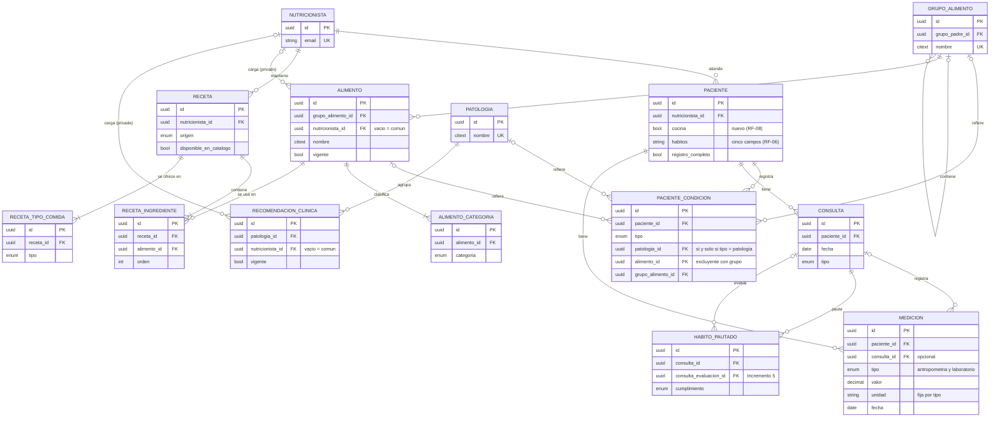

# Registro de decisiones y modelo de datos del Incremento 2

Insumo del Informe de Avance 3 (04/11/2026). Continúa la numeración DA de la Tabla 5
del Informe de Avances 2 (IA2), conforme al registro de decisiones de la sección 5.3 del
Plan de Proyecto. Cada decisión tiene su fundamento completo en
[`decisiones/`](decisiones/_indice.md). La revisión de los criterios de cierre está en
[`cierre-incremento-2.md`](cierre-incremento-2.md).

## Decisiones adoptadas en el Incremento 2

| ID | Decisión | Alternativas consideradas | Motivo y consecuencias |
|---|---|---|---|
| DA-15 | Alimentos, grupos de alimentos, patologías y recomendaciones clínicas son catálogos comunes a todos los nutricionistas. Las recetas pertenecen a cada nutricionista y se aíslan como los pacientes (DA-05). | Todos los catálogos por nutricionista. | RF-24 pide una base mínima controlada, y el motor de reglas del Incremento 3 debe validar contra la misma base para todos los profesionales. RF-30 pide recomendaciones reutilizables entre pacientes. Las recetas reflejan el criterio de cada profesional, y el Anexo A ya las asocia al nutricionista. Es un supuesto a confirmar en la entrevista de validación. |
| DA-16 | Ningún nutricionista modifica el catálogo común. Lo que carga cada uno (alimentos y recomendaciones) queda privado y solo él lo ve. Puede editar y dar de baja sus recomendaciones, pero no sus alimentos. Las correcciones del catálogo las hace un rol administrador, sin acceso a datos de pacientes. | Escritura abierta a todos los nutricionistas; catálogo compartido con un dueño por ítem; congelar los ítems en uso; implementar el rol administrador en este incremento. | El error de un nutricionista solo lo afecta a él. Un plan emitido no debe cambiar por una corrección posterior del catálogo: el ítem del plan (Incremento 3) guardará una copia del alimento, y el plan, una copia del texto de la recomendación. Los nombres de catálogo son únicos sin distinguir mayúsculas dentro de lo que ve cada nutricionista. Hasta que exista el rol administrador, el catálogo común se corrige por datos iniciales o por migración. |
| DA-17 | Los valores de laboratorio se modelan dentro de MEDICION, junto con la antropometría, con un tipo por medición (peso, talla, pliegue, circunferencia, colesterol, triglicéridos, glucemia y otro) y una unidad fija por tipo. | Una entidad de laboratorio separada; unidad libre con conversión automática. | Mantiene el modelo del Anexo A y un único histórico fechado, que reutilizarán los gráficos de evolución y las variaciones entre consultas (RF-19 a RF-21, Incremento 5). Ningún tipo es obligatorio (RF-12). Una unidad distinta de la esperada se rechaza en lugar de convertirse, para no guardar un valor que el profesional no escribió. El tipo "otro" exige un detalle y elige su unidad de una lista. Solo hay validaciones técnicas, sin umbrales clínicos. |
| DA-18 | El IMC se calcula en el backend al leer y no se persiste. Para cada peso se usa la talla más reciente con fecha igual o anterior a la del peso; sin esa talla, no se informa IMC. | Guardarlo como una medición más; calcularlo en el frontend; usar la última talla registrada sin considerar su fecha. | Es un dato derivado: guardado, se desincronizaría al corregir un peso o una talla. La regla vive en un solo lugar y la reutilizarán el plan, el documento exportado y el seguimiento. Una talla posterior al peso no se conocía en ese momento, lo que en un menor en crecimiento altera el valor. Se informa con un decimal y sin clasificación, porque las categorías serían una regla clínica. |
| DA-19 | Ajustes al modelo del Anexo A del IA1: campo nuevo "si cocina" (RF-08), distinto de "gusta cocinar"; hábitos (RF-06) divididos en cinco campos; fechas de alta y modificación en CONSULTA y RECETA; RECETA.plan_origen_id diferido al Incremento 3; IMC no persistido (DA-18); nutricionista opcional en ALIMENTO y RECOMENDACION_CLINICA (DA-16). Las restricciones que anota el diagrama se aplican en la base de datos y en la aplicación. | Implementar el Anexo A sin cambios. | RF-08 queda cubierto completo, y los hábitos llegan estructurados al contexto de la generación del Incremento 3. La integridad no depende solo de la aplicación. Se agrega la regla inversa de PACIENTE_CONDICION: la patología se informa si y solo si el tipo es patología, y las demás condiciones referencian exactamente un alimento o un grupo. Los catálogos y las recetas se dan de baja de forma lógica, y lo que pertenece al paciente se elimina con él. El esquema de Prisma es el modelo lógico vigente. |
| DA-20 | Los hábitos pautados se registran en el Incremento 2, al cierre de cada consulta: los redacta el profesional, sin catálogo predefinido, y nacen en estado pendiente. La evaluación de cumplimiento en una consulta posterior queda para el Incremento 5. | Registro y evaluación en el mismo incremento; catálogo predefinido de hábitos. | La evaluación forma parte del seguimiento (Incremento 5), junto con las métricas de evolución. Las columnas de evaluación ya existen desde este incremento, por lo que no requerirán una migración. Hasta entonces, los hábitos no se editan después de guardar la consulta. |
| DA-21 | El catálogo de alimentos contiene materia prima: alimentos que se consumen solos o como parte de una preparación (una fruta puede ser un postre o un ingrediente de una receta). Las preparaciones son recetas, no alimentos. El catálogo definitivo lo elabora el desarrollador a partir de recomendaciones de la bibliografía y de las conversaciones con nutricionistas, y se carga como datos iniciales. El incremento cierra con una base mínima: 15 grupos en dos niveles, 31 alimentos con sus categorías y las 3 patologías de los casos de prueba del Plan (celiaquía, diabetes e hipertensión), más una recomendación de ejemplo por patología identificada como ficticia. Los nutricionistas lo amplían con alimentos privados desde la interfaz. | Importar una tabla externa de composición de alimentos; incluir preparaciones en el catálogo de alimentos; alcanzar el volumen objetivo antes del cierre. | RF-24 define una base mínima de carga manual, sin integración con fuentes externas. Con materia prima, un mismo alimento sirve para las condiciones del paciente, los ingredientes de las recetas y los ítems del plan, y las reglas clínicas lo evalúan una sola vez. La base mínima alcanza para desarrollar y probar condiciones, recetas y el filtro de RF-28. La clasificación de grupos es neutra: qué grupo restringe cada patología lo define el motor de reglas, no el nombre del grupo. El volumen objetivo (150 a 250 alimentos) debe cargarse antes de evaluar la generación, porque los ítems de la propuesta se resuelven contra este catálogo. El contenido clínico real lo carga la nutricionista. |
| DA-22 | La ficha del paciente avisa que faltan datos clínicos cuando no hay registrada ninguna patología, alergia, intolerancia ni medicación (RF-45, parte de la ficha). El aviso se calcula en el backend. Rechazos y preferencias no cuentan. | Calcularlo en el frontend; avisar cuando falte cualquiera de los cuatro datos. | La regla queda disponible para el editor del plan, donde el Incremento 4 pedirá la confirmación antes de aprobar. Rechazos y preferencias expresan gustos, no restricciones clínicas. |
| DA-23 | Un ingrediente de receta referencia siempre un alimento del catálogo, nunca texto libre. El filtro de recetas por condiciones del paciente (RF-28) excluye las recetas con algún ingrediente comprendido en una alergia, intolerancia o rechazo, por alimento o por grupo, incluidos sus subgrupos. | Ingredientes en texto libre; filtrar también por patología. | La validación del Incremento 3 opera sobre datos estructurados (RF-39, RF-43). Lo que se deriva de una patología es una regla clínica del motor determinístico (Incremento 3), sujeta a la entrevista de validación. Las preferencias no excluyen recetas. RF-28, previsto como recortable, entró en este incremento. |
| DA-24 | Estrategia de pruebas con un tipo de prueba por objetivo: unitarias, integración del backend contra PostgreSQL, extremo a extremo del camino feliz en el navegador y carga sobre los umbrales de los requerimientos no funcionales. Cada tipo tiene su herramienta, su comando y su momento de ejecución. Actualiza DA-09. | Pruebas unitarias más verificación manual al cierre de cada incremento; conservar como herramienta los scripts de verificación usados en el cierre. | El cierre del Incremento 2 mostró lo que las pruebas unitarias no cubren: el aislamiento contra la base real, el recorrido por las pantallas y el tiempo de carga de la ficha (RNF-01), que se verificaron a mano. Al cierre del incremento solo están implementadas las unitarias; las demás se incorporan en tareas propias. |

## Actualización de decisiones del IA2

| ID | Estado al cierre del Incremento 2 |
|---|---|
| DA-09 | Ampliada por DA-24. |
| DA-12 | Sigue en evaluación. Los candidatos principales son Gemini 3.8 Flash y GPT-6 Luna (Tabla 6 del IA2); falta comparar el costo por generación y ejecutar el benchmark propio. Condiciona el inicio del Incremento 3. |
| DA-14 | Resuelta para el entorno de prueba (staging): Cloud Run en `us-central1` para los tres componentes, con escala a cero y como máximo una instancia; servicio de IA privado, invocado solo por el backend; PostgreSQL administrado en Supabase (plan gratuito); despliegue manual desde GitHub Actions. Se implementa cuando exista el servicio de generación de planes. El entorno de producción se define cuando el sistema esté implementado. |

## Incorporación de entidades por incremento (actualiza la Tabla 3 del IA2)

| Incremento | Entidades del IA1 | Estado |
|---|---|---|
| 1 | NUTRICIONISTA, PACIENTE (datos personales, objetivo, responsable, registro incompleto). | Implementado. |
| 2 | Datos clínicos y contextuales del PACIENTE; PATOLOGIA, PACIENTE_CONDICION, CONSULTA, MEDICION (antropometría y laboratorio), HABITO_PAUTADO; GRUPO_ALIMENTO, ALIMENTO, ALIMENTO_CATEGORIA; RECETA, RECETA_INGREDIENTE, RECETA_TIPO_COMIDA; RECOMENDACION_CLINICA. | Implementado, con los ajustes de DA-19. RECETA.plan_origen_id pasa al Incremento 3. |
| 3 | PLAN, PLAN_COMIDA, OPCION, OPCION_ITEM, REGLA_CLINICA, HALLAZGO, GENERACION_IA; RECETA.plan_origen_id. | Previsto. OPCION_ITEM guarda una copia del alimento (DA-16). La composición esperada por tipo de comida (RF-26) se incorpora como configuración. |
| 4 | Estados de aprobación, versionado y vínculo entre planes; fechas de aprobación y exportación. | Previsto. |
| 5 | Sin entidades nuevas: la evaluación de cumplimiento usa las columnas de HABITO_PAUTADO creadas en el Incremento 2 (DA-20). | Previsto. |

## Modelo lógico vigente

El archivo `nutria-backend/prisma/schema.prisma` es el modelo lógico vigente, construido
con cuatro migraciones reproducibles desde una base vacía:

| Migración | Incremento | Contenido |
|---|---|---|
| `20260914025743_init` | 1 | NUTRICIONISTA y PACIENTE. |
| `20261014203321_agrega_datos_clinicos_consultas_y_catalogos` | 2 | Datos clínicos y contextuales, consultas, mediciones, hábitos pautados y catálogos, con sus restricciones. |
| `20261015180000_agrega_alimentos_privados_y_nombres_sin_mayusculas` | 2 | Alimentos privados por nutricionista; nombres de catálogo sin distinguir mayúsculas. |
| `20261024190253_agrega_recomendaciones_privadas` | 2 | Recomendaciones clínicas privadas por nutricionista. |

La correspondencia de cada entidad y atributo del Anexo A con su tabla y columna, y la
lista de restricciones que la base aplica, están en
[`ajustes-al-modelo-del-anexo-a-incremento-2.md`](decisiones/ajustes-al-modelo-del-anexo-a-incremento-2.md).
El diagrama usa los nombres del Anexo A y muestra solo identificadores, claves foráneas y
los atributos que intervienen en las decisiones de este registro.

